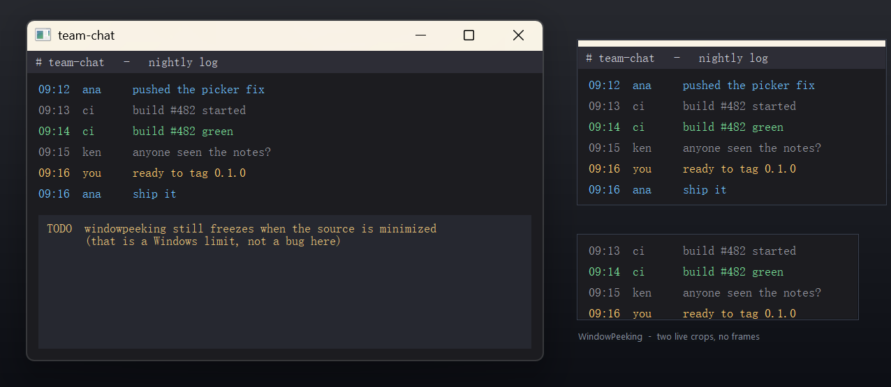
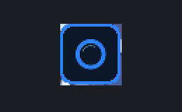

# WindowPeeking

**English** | [中文](README_zh.md) | 

A borderless, always-on-top live view of any window region on Windows.
Peek at one part of another window while that window stays in the background —
as many parts, of as many windows, as you like.



Built on the DWM thumbnail API, the same mechanism as PowerToys *Crop And Lock*
(Thumbnail mode), but with **no title bar and no frame** — just the pixels.

## Using it

**First run: double-click `install.cmd`.** It installs the program to
`%LOCALAPPDATA%\Programs\WindowPeeking`, adds a desktop shortcut and starts it from
there — which also sidesteps a Windows trap: an exe started out of this repository
folder runs at low integrity, and a low-integrity process may not register a tray
icon (see "No tray icon?" below). Already installed elsewhere? Just run the exe.

```
Ctrl+Alt+P   pick a window and drag out the region you want
Ctrl+Alt+Q   close every preview and quit
```

Once a preview exists, everything else is done with the mouse on the preview
itself and with the tray icon:

**Drag semantics (this is the specification — do not reinterpret it):**

| | No Shift | Hold Shift |
| --- | --- | --- |
| **Corner drag** | **Zoom**: window and picture grow or shrink together, aspect ratio locked, **the crop never moves** (same region, seen bigger) | **Crop**: each axis follows its own handle, any aspect ratio goes |
| **Edge drag** | **Crop**: only that one side moves, the other dimension is untouched | **Crop**: same as without Shift, one side only |
| **Body drag** | **Move the window** on screen, crop untouched | **Pan the viewfinder**: the frame stays, a different part of the source is read |
| **Wheel** | — | **Opacity** (10%–100%) |

| Action | How |
| --- | --- |
| Zoom in on the same piece | Drag a corner (no Shift): window and picture scale together, crop frozen, up to 8× |
| Crop the viewfinder | Drag an edge (no Shift): one side at a time, and it still follows the pointer while zoomed |
| Any aspect ratio | Hold **Shift** and drag a corner or an edge |
| Move on screen | Drag the body without Shift |
| Slide the view | Hold **Shift** and drag the body: same size, same place, a different part of the source |
| Opacity | Hold **Shift** and turn the mouse wheel (10%–100%) |
| Menu | Right-click: new preview, opacity presets, click-through, close this preview, close all, quit |
| Click-through | The menu item, or the tray icon — the mouse **and** the keyboard then go to the window underneath |
| Another preview | Press Ctrl+Alt+P again, right-click a preview, or double-click the tray icon — previews are independent (own window, own region, own position, opacity and click-through state) |
| Close all / quit | The tray icon (or the fallback button when Windows refuses one); its tooltip shows how many previews are open |

Two separate things. The **crop** is a rectangle in the source window's own
coordinates: it says *what* you see. The **zoom** is preview size ÷ crop size: it
says *how big* you see it.

- Drag an **edge**, or hold **Shift** and drag a **corner**: change the crop —
  genuinely one more or one less strip of the source, drawn at the current zoom,
  with the grabbed edge glued to the pointer.
- Drag a **corner** with no Shift: change the zoom — the crop does not move a
  pixel, the window and the picture scale together, ratio locked, up to 8× and
  never below 64 × 48.
- Drag the **body**: move the window on screen. Shift-drag the body: the window
  stays, a different part of the source is read.
- **Shift + wheel**: opacity.

The interface is in Chinese.

Other behaviour:

- A new preview starts at 1:1: the frame covers exactly as much source as it is
  wide at first, and only a corner drag begins to zoom
- Stays on top of everything, never appears in the taskbar or Alt-Tab, and never
  steals keyboard focus even when it is not click-through
- Closing the source window leaves a hint in the preview instead of a dead black
  rectangle
- Single instance: starting it again just asks the running copy for a new preview

## Why not PowerToys Crop And Lock

PowerToys' thumbnail mode works well but keeps a normal window frame including
the title bar. If you want a small strip of a chat window or a video pinned in a
corner with nothing but pixels, that frame costs space and attention.
WindowPeeking drops it: `WS_POPUP`, no caption, no border, nothing but pixels.

## Build

Requires Windows 10/11 and a C++ toolchain (MSVC 2019+ / Build Tools with the
Windows SDK). No dependencies, no NuGet, no CMake.

```cmd
build.cmd            :: needs the Visual C++ runtime (VCRUNTIME140 / MSVCP140)
build.cmd release    :: self-contained - system DLLs only, no redist needed
```

Output: `build\windowpeeking.exe`. The release build links the C runtime
statically (`/MT /GL /LTCG`) and imports nothing but GDI32, USER32, KERNEL32 and
dwmapi, so it runs on a clean Windows install; the normal build is smaller but
wants the Microsoft Visual C++ Redistributable.

The icon and version resource are compiled from `app.rc`, so the executable also
carries a tray icon. Sources are UTF-8 and are built with `/utf-8`.

Self-tests (they create their own windows; nothing is installed):

```cmd
build\windowpeeking.exe --selftest         :: 62 checks: borderless geometry, corner zoom, edge cropping at any zoom, Shift corner crop, Shift-slide, wheel opacity, click-through, icon, tray owner window, several previews at once, the fallback button
build\windowpeeking.exe --selftest-picker  :: selection maths and hit testing
build\windowpeeking.exe --selftest-e2e     :: real DWM thumbnail, verified by sampling pixels -- including that dragging an edge in brings new source pixels into view instead of stretching the old ones
build\windowpeeking.exe --demo             :: the scene in the screenshot above, for eyeballing
```

## Known limits

- **A minimized window is frozen.** Windows stops composing a window once it is
  minimized, so there is nothing live to mirror. Keep the source window on the
  same desktop, behind other windows — being *covered* is fine, being
  *minimized* is not.
- Exclusive full-screen applications (bypassing DWM) cannot be mirrored.
- Windows on another virtual desktop are cloaked by DWM and appear frozen.
- While click-through is on, the preview ignores the mouse completely, so use the
  tray icon to switch it back off.
- Opacity stops at 10%; below that the preview would be impossible to find again.
- On Windows 11 the tray icon starts out folded into the "show hidden icons"
  overflow; drag it onto the taskbar to keep it there.
- **Started from a de-privileged folder (this repository included), the tray icon is refused
  and the program cannot rescue itself**: a low-integrity process cannot create anything in
  your profile (`CreateDirectory` returns 5) and cannot start a higher-integrity child either
  (measured: the handed-over copy stays low and stays tray-less). The cure has to come from
  outside — double-click `install.cmd` or the desktop shortcut and run the copy under
  `%LOCALAPPDATA%\Programs\WindowPeeking`. `--relocated` only stops the program from
  re-launching itself (the self tests use it). See the next section.

## No tray icon?

The tray is the permanent entry point, but registering an icon runs into a Windows rule:
explorer (the taskbar) is a medium-integrity process, and a process of lower integrity that
asks it to add an icon is simply refused (`NIM_ADD` returns error 5). Windows decides that
integrity level **from the folder the exe lives in**: anything launched out of this repository
folder is downgraded, no matter who double-clicks it.

The same `whoami.exe`, started by the same medium-integrity cmd:

| Started from | Integrity | `NIM_ADD` |
| --- | --- | --- |
| `C:\Windows\System32\whoami.exe` | medium (0x2000) | — |
| the same file copied into `build\` | low (0x1000) | `ok=0 err=5` refused |
| the same file copied into `%LOCALAPPDATA%\Programs\` | medium (0x2000) | `ok=1 err=0` accepted |

So there is exactly one cure, and it has to come from **outside**: **move the exe to an
ordinary folder and start it there.** A low-integrity process cannot do that for itself — it
cannot create the directory, and any child it starts inherits the low integrity level.

```
install.cmd            :: double-click: copies the exe to
                       :: %LOCALAPPDATA%\Programs\WindowPeeking, adds a desktop
                       :: shortcut, and starts it from there (tray icon works)
```

Explorer is what makes the difference: double-clicking `install.cmd` runs `cmd.exe` (a
System32 binary, so medium integrity) and that process does have the rights to copy into your
profile. Started from a folder it is allowed to write, a refused tray also makes the program
copy itself there and hand over (`relocate: ...` in the log), and the menu offers the same
thing as "install to your user folder" — but from a de-privileged folder that path is closed,
which is exactly why the shortcut matters.

If registration is still refused (system policy, security software), the program does not
wait and paints a 44×44 **floating button** just above the bottom-right corner of the work area:

| Click | What happens |
| --- | --- |
| Left click / double click | New preview (same as Ctrl+Alt+P) |
| Right click | The *same* menu as the tray icon: new preview, click-through, close all, quit |
| Drag | Move it anywhere; it returns to the corner next launch |

A small green dot appears in its corner while previews are open. If the icon did register,
the button never appears — you get one or the other, never both.

To see it on purpose: `build\windowpeeking.exe --island`.



The program also keeps a log, so you can tell which of the two happened:

```
%LOCALAPPDATA%\WindowPeeking\tray.log      or tray.log beside the exe if that folder is refused
```

Every line is timestamped: `start`, `NIM_ADD ... ok=0 err=5`, `access denied ...`,
`tray unavailable, showing the floating button at (x,y)`, `explorer restarted`. Windows 11
also folds new icons into "show hidden icons" (^) by default, so a registered icon is simply
not on the taskbar until you drag it there.

And the preview's own right-click menu does everything too — new preview, opacity,
click-through, close this preview, quit — so a missing entry point is inconvenient, not fatal.

## Credits

The DWM thumbnail parameters and the scale-to-fit maths are derived from
Microsoft PowerToys *Crop And Lock* (MIT). See `THIRD-PARTY-NOTICES.md`.

## License

MIT — see `LICENSE`.
