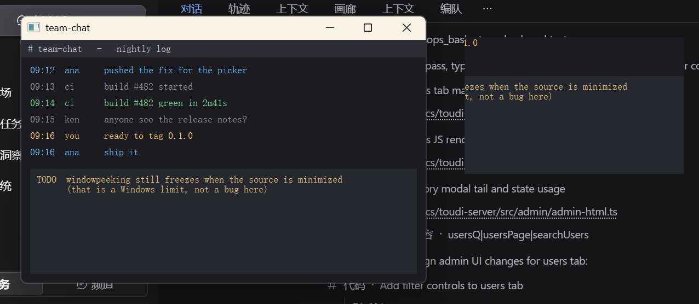

# WindowPeeking

[English](README.md) | **中文** | 

Windows 上任何窗口的**无边框、置顶、实时局部预览**：实时看一眼另一个窗口的某一小块，
而那个窗口继续留在后台干活。



底层用 DWM 缩略图，和 PowerToys 的「裁剪与锁定」（Thumbnail 模式）同一机制，
但**没有标题栏、没有边框**，只有画面。

```
Ctrl+Alt+P   选窗口，并框出你想看的那块区域
Ctrl+Alt+O   切换点击穿透（鼠标点击直接落到下层窗口）
Ctrl+Alt+Q   退出
```

- 拖窗口本体移动；拖边缘/四角缩放（八方向，手写命中测试）
- 尺寸随意，画面按比例缩放居中，多出来的地方填黑边
- 永远置顶，不进任务栏、不进 Alt-Tab

## 为什么不直接用 PowerToys

PowerToys 的裁剪窗口功能很好用，但它保留了一个普通窗口框（含标题栏）。如果你
只想在角落钉一小条聊天记录或视频画面，那个框既占地方又碍眼。WindowPeeking 把它去掉：
`WS_POPUP`、无标题、无边框、黑边填充。

## 编译

需要 Windows 10/11 和 C++ 工具链（MSVC 2019+ 或 Build Tools + Windows SDK）。
无第三方依赖，不需要 CMake。

```cmd
build.cmd            :: 67 KB，依赖 Visual C++ 运行库（VCRUNTIME140 / MSVCP140）
build.cmd release    :: 203 KB，静态链接，只依赖系统 DLL，不需要装 redist
```

产物：`build\windowpeeking.exe`。release 版把 C 运行库静态链进去
（`/MT /GL /LTCG`），导入表里只有 GDI32、USER32、KERNEL32、dwmapi，拷到干净的
Windows 上直接能跑；普通版体积只有三分之一，但需要 Microsoft Visual C++ 运行库。

自测（自己建临时窗口，不写注册表、不装任何东西），两个构建版本都跑这 29 项：

```cmd
build\windowpeeking.exe --selftest         :: 无边框几何、拖动、缩放、置顶
build\windowpeeking.exe --selftest-picker  :: 选区换算与命中测试
build\windowpeeking.exe --selftest-e2e     :: 真 DWM 缩略图 + 采样像素验证
build\windowpeeking.exe --demo             :: 上面截图里的那个演示场景
```

## 已知限制

- **窗口最小化后会冻结。** Windows 对最小化窗口停止合成，没有实时画面可镜像。
  让它留在同一个桌面、被别的窗口盖住就行 —— **被遮挡没问题，最小化不行**。
- 独占全屏（绕过 DWM）的程序无法镜像。
- 位于另一个虚拟桌面的窗口会被 DWM 隐藏（cloaked），显示为冻结画面。
- v0.1 暂无托盘图标：启动后无提示，`Ctrl+Alt+Q` 关闭所有预览窗口并退出。

## 致谢

DWM 缩略图参数与等比缩放算法来自微软 PowerToys 的「裁剪与锁定」（MIT）。
详见 `THIRD-PARTY-NOTICES.md`。

## 许可

MIT，见 `LICENSE`。
